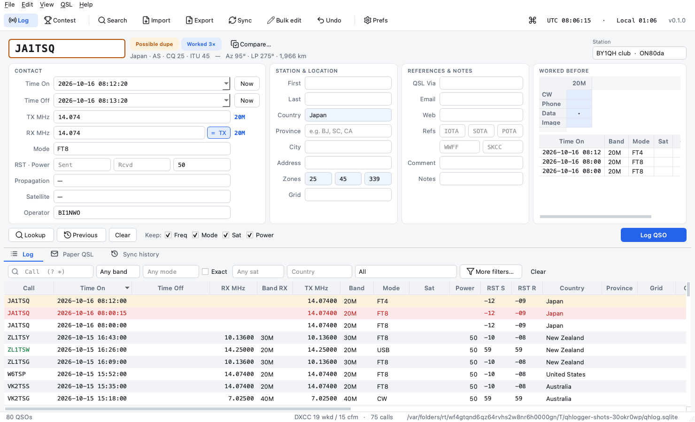
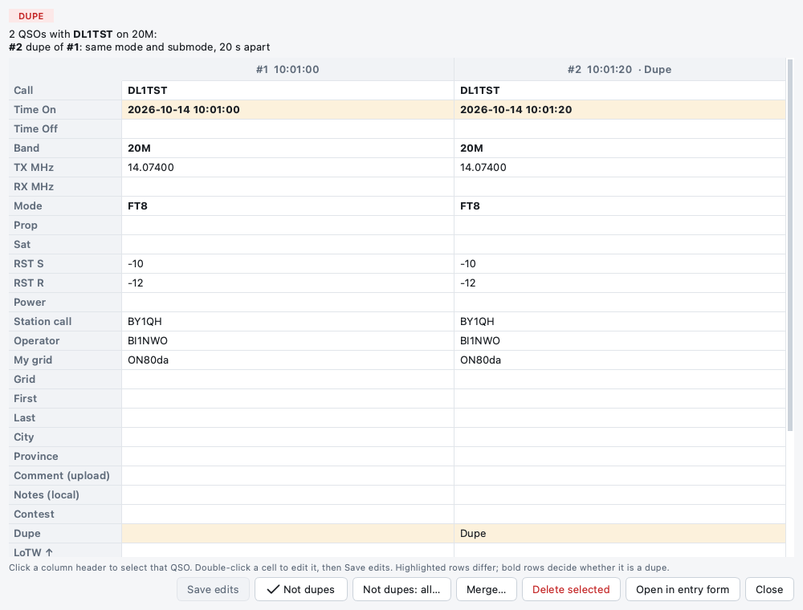
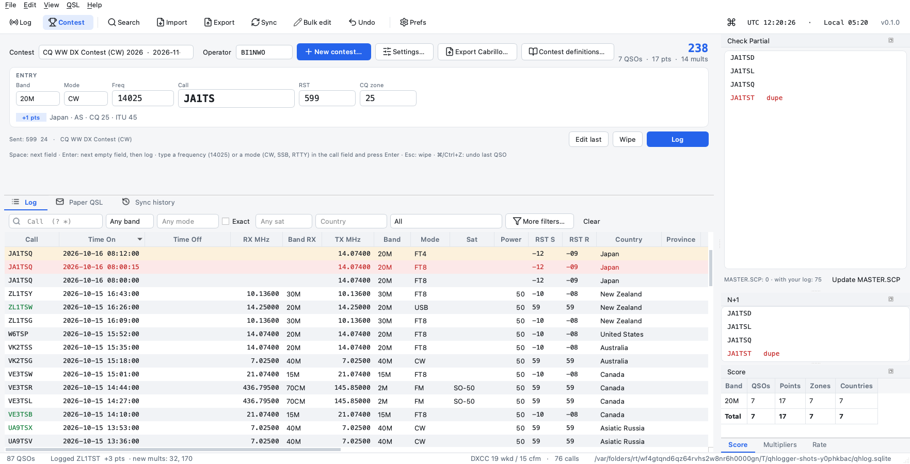
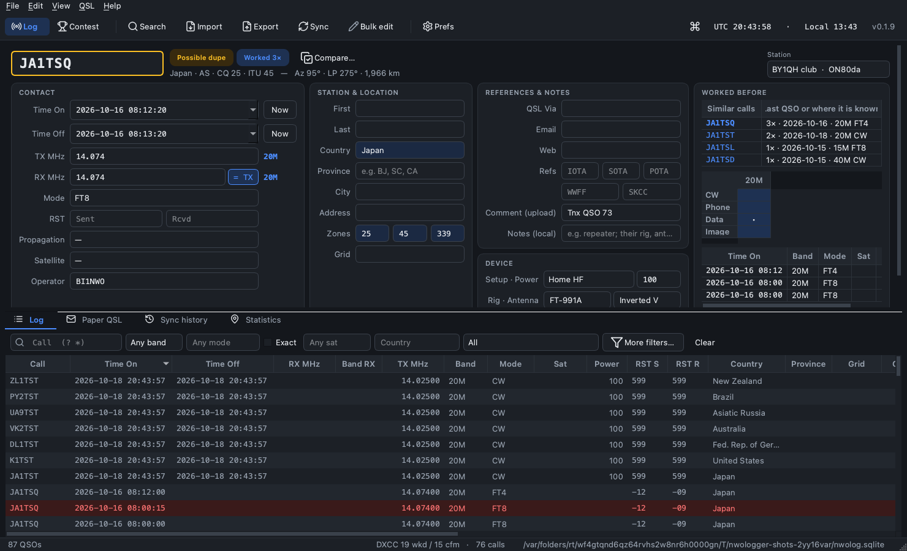
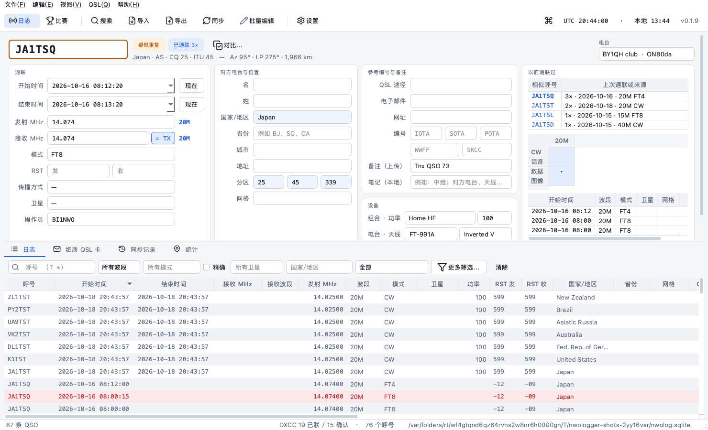
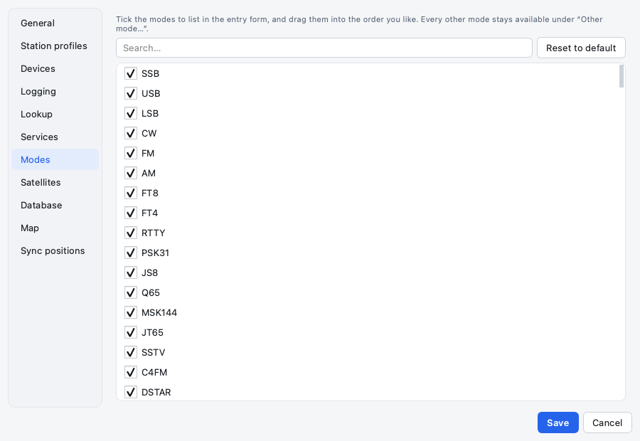
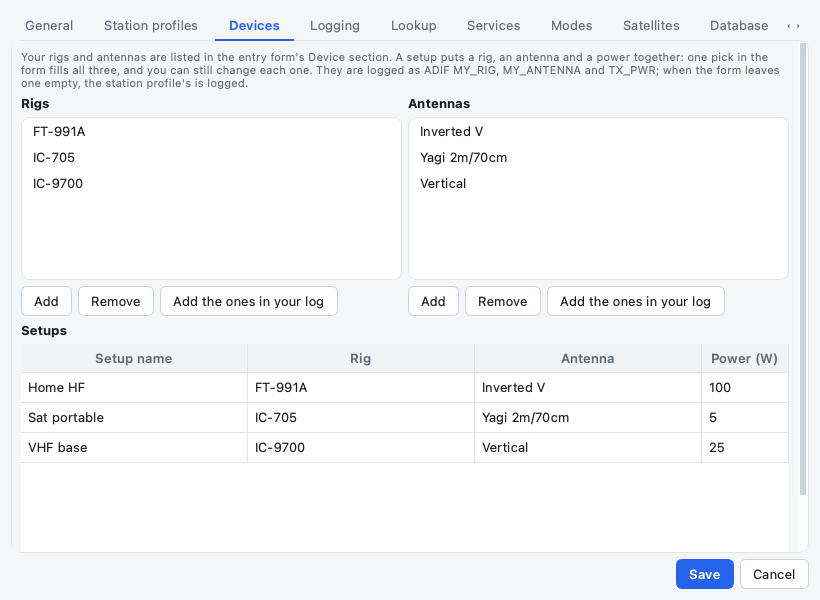

# NWOlogger

A minimal, cross-platform amateur radio logger for macOS and Windows. It is modelled on
**MacLoggerDX** for everyday logging and on **N1MM Logger+** for contesting, with its own
modern UI, and built with Python and Qt (PySide6).

> - Logging, search, bulk edit, dupe review, paper QSL tracking, ADIF, MacLoggerDX migration and contest mode work and are tested.
> - Uploads to LoTW, eQSL, QRZ.com and HRDLog, downloads from LoTW, eQSL and QRZ.com, and QRZ.com lookups have been tried with real accounts. HamQTH has not yet.
>
> - **Design:** [PLAN.md](PLAN.md)
> - **Remaining work:** [TODO.md](TODO.md)

## Screenshots


*Main window: the entry form above the log. The call is flagged as a possible dupe while you type, and **Compare…** opens the dupe window. Worked before lists similar calls: here three calls one letter away from JA1TSQ.*

| | |
|---|---|
|  |  |
| *A group of three possible dupes side by side. Cells are editable; keep one and merge the others.* | *Contest mode (CQ WW): entry line, live score, Check Partial and N+1.* |
|  |  |
| *Dark theme* | *简体中文* |
|  |  |
| *Preferences → Modes: choose and order the modes in the dropdown* | *Preferences → Devices: your rigs, antennas and setups* |

All screenshots use made-up QSOs. To regenerate them, run `uv run python tools/screenshots.py`.

## Try it

You need [uv](https://docs.astral.sh/uv/). It fetches the right Python (3.12) by itself.

| | Install uv |
|---|---|
| macOS | `curl -LsSf https://astral.sh/uv/install.sh \| sh` |
| Windows (PowerShell) | `powershell -ExecutionPolicy ByPass -c "irm https://astral.sh/uv/install.ps1 \| iex"` |

```sh
git clone https://github.com/doublehan07/NWOlogger.git
cd NWOlogger
uv sync                                       # install dependencies (first run takes a minute)
uv run nwologger --db ~/nwologger-test.sqlite   # use a throw-away log file for testing
```

Without `--db`, NWOlogger uses `~/Documents/NWOlogger/nwolog.sqlite`. Other options: `--lang zh_CN`, `--theme dark|light`, `--debug` (more detail in the diagnostic log), `--version`.

**A first test, step by step:**

1. **Create a station profile** when asked. Choose *Club station* if several people operate the call; the Operator field in the entry form must then be filled in. Double-click a profile to make it the default.
2. **Import the sample log:** File → Import, then pick [`tests/fixtures/sample.adi`](tests/fixtures/sample.adi). These are 17 made-up QSOs: a satellite pass, HF FT8/SSB/CW, one strict dupe and one suspicious dupe. When asked, review the dupes side by side.
3. **Log a QSO.**
   - Type a call. Country, zones and Chinese provinces fill in by themselves (tinted).
   - Try TX/RX MHz with the **= TX** toggle, the Mode, Propagation and Satellite dropdowns (choose what they list in Preferences → Modes / Satellites), and Enter to log.
   - **Device:** add your rigs, antennas and setups in Preferences → Devices. Picking a setup fills rig, antenna and power at once; change any of them for the QSO if needed.
   - **Comment (upload)** goes to eQSL, QRZ.com and HRDLog with the QSO (your name, a thank-you). **Notes (local)** are only for you: the repeater you used, their rig, antenna and power, where you operated from.
   - Change Time On and see Time Off move to Time On + 1 min. **Now** next to Time On puts both back on the clock.
   - Type part of a call: **Worked before** lists similar calls, your log first, then calls QRZ.com / HamQTH know, then LoTW users and eQSL AG members, then [MASTER.SCP](https://www.supercheckpartial.com/) (File → Update MASTER.SCP). Try a call with a letter or the digit missing, e.g. `BINWO`, or a pattern with `*` and `?`, e.g. `BA*K`. Click one to use it.
   - **Clear** (Esc) empties the contact: frequency, mode, reports, propagation and satellite included. Your Device section (rig, antenna, power) stays. The *Keep* boxes only apply after Log QSO.
4. **Search:** `BA*` or `B?1*` in the call box; mode `SSB` (finds USB/LSB) with and without *Exact*; presets such as *Suspicious dupes* and *Paper to send*.
5. **Edit many QSOs:** select several rows → right-click → Bulk edit. Undo with ⌘Z / Ctrl+Z.
6. **Contest mode:** toolbar → Contest → New contest. Pick CQ WW, log with Space / Enter, watch the score and the Check Partial pane, then Export Cabrillo.
7. **Your own data:** File → Import accepts ADIF files and MacLoggerDX databases (`MacLoggerDX.sql`).
8. **Services (optional):** Preferences → Lookup / Services for QRZ.com, HamQTH, LoTW (needs [TQSL](https://www.arrl.org/tqsl-download)), eQSL and HRDLog.
   - Passwords are kept in the system keychain and never shown again; *Forget* removes one.
   - Reports from real accounts are especially welcome.

**Reporting a problem:** open an issue on GitHub. Include what you did, the text from Help → About → System → *Copy system info*, and the diagnostic log: Help → *Show log folder*, then attach `nwologger.log`. The log never contains a password, API key or upload code, and the *ref* shown with a sync result points to that run in the log.

**For developers:**

```sh
uv run pytest      # tests (Qt runs off-screen; they never reach the network or your keychain)
uv run ruff check  # lint
uv run --with pyinstaller --with pillow pyinstaller packaging/nwologger.spec --noconfirm   # stand-alone app in dist/
```

Pushing a tag `vX.Y.Z` that matches the `pyproject.toml` version makes GitHub Actions build a macOS `.dmg` and a Windows installer.

## Features

- **One SQLite file** holds every QSO.
  - Columns are plain ADIF names, so the log can be queried with any SQLite tool.
  - The log is backed up automatically on open and before every import or bulk edit.
- **ADIF import and export:** export all, selected, or filtered QSOs. Fields NWOlogger doesn't know are kept and written back out.
- **MacLoggerDX migration** straight from its database. It keeps the LoTW, eQSL, QRZ and HRDLog upload history and the paper card dates that MLDX's own ADIF export drops.
  - MacLoggerDX only records the uploads it made itself. A QSO that LoTW or QRZ.com confirmed must have been uploaded there, so it is marked uploaded too (ADIF imports get the same rule); the import preview counts them. Download from LoTW and QRZ.com before your first upload to mark the rest.
- **Search** across several criteria at once, with `?` / `*` wildcards on callsigns. Mode search is vague by default (`SSB` finds USB/LSB, `DIGI` finds FT8), with an *Exact* option. Searches can be saved.
- **Sorting** by any column, including satellite name, time on and time off. Columns can be shown, hidden and moved.
- **Entry form:**
  - TX / RX MHz, with an *= TX* sync toggle.
  - Dropdowns for mode, propagation (TQSL's list) and satellite.
    - You choose which modes and satellites are listed; *Other…* reaches the rest.
    - You can add your own satellites.
    - A satellite with a non-SAT propagation is kept, with a warning.
  - A **Device** section with your rig (`MY_RIG`), antenna (`MY_ANTENNA`) and power (`TX_PWR`). A *setup* you put together in Preferences → Devices fills all three in one pick, and each can still be changed. Empty fields log the station profile's.
  - *Comment (upload)* (`COMMENT`, sent to eQSL, QRZ.com and HRDLog) and *Notes (local)* (`NOTES`, never uploaded): the repeater you used, the other station's rig, antenna and power, your QTH.
  - Time Off follows Time On + 1 min. A Time Off earlier than Time On is refused. *Now* next to Time On goes back to the live clock.
  - Fields stay set for a whole satellite pass (*Keep*). *Clear* empties the contact and keeps your Device section.
  - An empty rig, antenna or power uses the station profile's, shown in grey.
- **Similar calls** in Worked before, while you type: the same call, calls that start with or contain what you typed, and calls one character away (a typo, or a missing letter or digit). Your log comes first (most recent first), then calls QRZ.com / HamQTH know, then the calls of ARRL's [LoTW user list](https://lotw.arrl.org/lotw-user-activity.csv) and eQSL's AG member list (about 320,000 calls, with the date of each call's last LoTW upload), then MASTER.SCP. When a call is not found on QRZ.com / HamQTH, up to three MASTER.SCP calls one letter away are looked up there. With `*` or `?` the call field searches every source like the log's search box (`BA*K` → BA1PK, BA8BLK).
  - QRZ.com and HamQTH can only look up a complete call, so the lists are downloaded instead (next to the log file, refreshed weekly; File → Update LoTW and eQSL call lists) and searched on your computer while you type.
- **Operators:** an Operator field in the entry form.
  - Personal stations fill in your call.
  - Club stations must enter the operator, which then stays for the session.
  - On a new UTC day or after a 3-hour break, the field turns amber once to be checked.
- **Strict dupe checking:**
  - Only the same call, band and exact mode within 30 seconds blocks logging.
  - The same mode later, or a related mode (SSB vs USB, USB vs LSB, FT8 vs FT4), only warns.
  - A side-by-side compare window shows a whole group of possible dupes, one column per QSO. Edit the cells there, or keep one QSO and merge the others into it, delete one, or mark them as not dupes.
- **Bulk edit** of a selection, with a preview and undo.
- **Electronic confirmations, tracked per service:** LoTW (via TQSL), eQSL and QRZ.com Logbook (upload and download), and HRDLog.net (upload only). Satellite names are translated per service: the ISS is `ARISS` for LoTW and `ISS` for eQSL.
  - A call is **green** when LoTW confirmed the QSO (eQSL, QRZ.com and paper cards don't make it green).
  - **Uploads are always your choice.** *Sync everything* only downloads. QSOs not yet uploaded to all four services are shown in grey (the tooltip names the missing services); the preset *Not uploaded to every service* lists them, and *Upload selected* sends them.
  - Downloads also record what is already uploaded: LoTW's report of accepted QSOs and the QRZ.com logbook mark those QSOs as uploaded. eQSL (it only offers your inbox) and HRDLog (no download) can't tell NWOlogger what you uploaded there before.
  - Every outcome goes to one **Sync results** window that never blocks the app (QSL → Show sync results). A row that a setting can fix has *Open Preferences*.
  - **Sync history** keeps every run; *Clear history…* (or QSL → Clear sync history…) deletes it for the services you choose, e.g. only QRZ.com. Your QSOs and their upload and confirmation status are not touched.
  - Checked before anything is sent: the TQSL station location (Preferences offers the locations TQSL has) and the eQSL QTH nickname of each station profile.
  - TQSL can wait in its own window (e.g. for your certificate passphrase); *Cancel* stops it, and quitting NWOlogger asks first, then stops it instead of waiting.
- **Paper QSL cards** tracked separately (sent and received dates, via bureau, direct or manager), with a "to send" queue.
- **Callsign lookup:** offline country file (`cty.csv`, updated weekly), then QRZ.com XML with HamQTH as fallback. Chinese provinces are normalised to standard codes (BJ, SC, …).
- **Contest mode (N1MM style):**
  - Contest picked from a dropdown: CQ WW, CQ WPX, IARU HF, ARRL DX, ARRL 10 m, All Asian, CQ WW VHF, generic templates, and your own.
  - Live dupe check, Check Partial / N+1, and live score / multipliers / rate.
  - Cabrillo export.
- **Modern UI** with light and dark themes, keyboard-first (command palette ⌘K / Ctrl+K), in **English and 简体中文**.

No rig control, by design: NWOlogger never talks to a radio.

## Keyboard

| Keys | Action |
|---|---|
| Enter | Log the QSO (DX); in contest mode, go to the next empty field and then log |
| Esc | Clear the whole form / wipe the contest entry line |
| Space (contest) | Next field |
| `14025` + Enter, `CW` + Enter (contest call field) | Set the frequency or mode |
| ⌘K / Ctrl+K | Command palette |
| ⌘L / Ctrl+L | Focus the call field |
| ⌘F / Ctrl+F | Search log |
| ⌘B / Ctrl+B | Bulk edit the selection |
| ⇧⌘D / Ctrl+Shift+D | Review suspicious dupes |
| ⇧⌘O / Ctrl+Shift+O | Go to the Operator field |
| ⌘Z / Ctrl+Z | Undo (log, edit, bulk edit, delete, import) |
| ⌘1–3 / Ctrl+1–3 | Log · Paper QSL · Sync history tabs |
| ⇧⌘1 / ⇧⌘2 | DX view / Contest view |

## What is where

```
NWOlogger/
├── nwologger/                  the app (Python package)
│   ├── __main__.py            command line: nwologger [--db FILE] [--lang zh_CN] [--theme dark] [--debug] [--version]
│   ├── app.py                 starts Qt: language, theme, log file, main window
│   ├── applog.py              the diagnostic log file (secrets masked), hang watchdog
│   ├── i18n.py                tr(): looks up UI text in resources/translations/
│   ├── core/                  all logic, no Qt (unit-tested)
│   │   ├── db.py              the SQLite log file: schema, migrations, backups, undo
│   │   ├── fields.py          one entry per QSO column: ADIF name, type, label
│   │   ├── qso.py, adif.py    QSO cleaning; ADIF reader / writer
│   │   ├── importer.py, exporter.py, mldx.py      import (dupe marking, merge), export, MacLoggerDX
│   │   ├── search.py          filters → SQL (wildcards, vague / exact mode)
│   │   ├── dupes.py, modes.py, bands.py           dupe rules, mode relations, band plan
│   │   ├── callsign.py, dxcc.py, regions.py, geo.py   calls, country file, China provinces, grids
│   │   ├── similar.py         similar calls for Worked before (log, QRZ.com / HamQTH cache, call lists, MASTER.SCP)
│   │   ├── calllists.py       LoTW user and eQSL AG member lists: download and fast search
│   │   ├── net.py, secrets.py HTTPS to the services only, no secrets in messages; keychain access
│   │   ├── sats.py, propagation.py                satellites and per-service names; TQSL propagation modes
│   │   ├── operators.py       personal / club station operator
│   │   ├── devices.py         rigs, antennas and setups for the Device section
│   │   ├── lookup/            QRZ.com XML, HamQTH
│   │   ├── sync/              LoTW + TQSL, eQSL, QRZ.com Logbook, HRDLog; applying confirmations
│   │   └── contest/           scoring engine, built-in definitions (defs/*.json), Check Partial, Cabrillo
│   ├── ui/                    Qt windows and widgets
│   │   ├── main_window.py     toolbar, menus, tabs, actions
│   │   ├── entry/dx_panel.py  the DX entry form
│   │   ├── log/               log table model / view, filter bar, advanced search
│   │   ├── contest/           contest entry line and panes, setup, user-defined contests
│   │   ├── dupe_dialog.py     side-by-side dupe groups: compare, edit, merge
│   │   ├── operator_field.py  the Operator field (personal / club station rules)
│   │   ├── list_picker.py     "Other mode… / Other satellite…" search
│   │   ├── bulk_edit.py, qsl_paper.py, import_dialog.py, prefs_dialog.py, about_dialog.py, …
│   │   └── theme.py           colours, light / dark stylesheet, icons
│   └── resources/             cty.csv, sats.json, icons (Lucide), brand/ (app icon), translations/zh_CN.json
├── tests/                     pytest suite; fixtures/sample.adi is a synthetic log for trying the app
├── tools/screenshots.py       renders docs/screenshots/ from made-up data
├── docs/screenshots/          the README screenshots
├── packaging/                 PyInstaller spec, Inno Setup script (Windows installer)
├── .github/workflows/         CI (tests on macOS + Windows) and release builds
├── PLAN.md, TODO.md           design and remaining work
└── pyproject.toml, uv.lock    project metadata and pinned dependencies
```

## Privacy

- Passwords, upload codes and API keys go to the system keychain only (macOS Keychain / Windows Credential Manager). Any other keyring backend, such as a plaintext file, is refused.
  - Saved secrets are never shown again. *Forget* in Preferences removes one; renaming an account removes the old account's entry.
  - Deleting the last station profile with a callsign removes that callsign's QRZ Logbook key.
- Error messages, sync history and logs never contain a password, key, upload code or session token, even when a service echoes one back encoded. Requests go over HTTPS to each service's own hosts only, redirects included. QRZ.com XML gets the password and session key in the request body; LoTW and eQSL only accept them in the (encrypted) URL. HTTP request logging stays off even when the app logs at DEBUG.
- The diagnostic log (`~/Library/Logs/NWOlogger/` on macOS, `%LOCALAPPDATA%\NWOlogger\Logs` on Windows, `~/.local/state/nwologger/` on Linux) masks every secret and account user name NWOlogger has read, also inside tracebacks and echoed error pages, logs requests by host and path only (never the URL query), and shows your home folder as `~`. It holds counts and settings names, not your QSOs.
- The LoTW user and eQSL AG lists are public files, downloaded without a login; nothing you type is sent anywhere to search them.
- Uploads to LoTW, eQSL, QRZ.com and HRDLog send only standard ADIF fields, never another program's `APP_…` fields, and never a field holding one of your saved secrets. Imported fields that look like credentials (`EQSL_PSWD`, `…PASSWORD…`, `…TOKEN…`, `APP_…_KEY`) are left out, and never exported.
- Never commit real log files. `*.sql`, `*.sqlite`, `*.adi` and similar are git-ignored because they contain other operators' personal data. Only synthetic files under `tests/fixtures/` are committed.

## Credits

- **Authors:** Han Zhang (BI1NWO) and Claude Opus 5.5 Extra High (Anthropic). Copyright © 2026 Han Zhang.
- **Special thanks** to the [BY1QH](https://www.qrz.com/db/BY1QH) club station.
- **Data:** AD1C country files ([country-files.com](https://www.country-files.com/)), ARRL LoTW / TQSL lists, Super Check Partial.
- **Software:** icons by [Lucide](https://lucide.dev/) (ISC); Qt for Python (PySide6).

Every commit message is a single brief sentence.

## License

[MIT](LICENSE)
