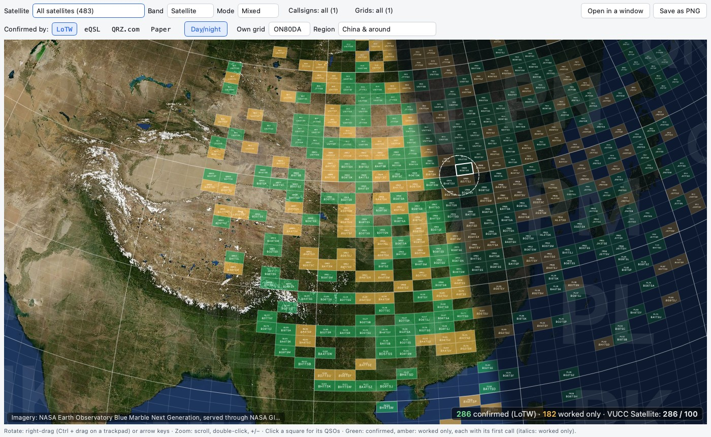
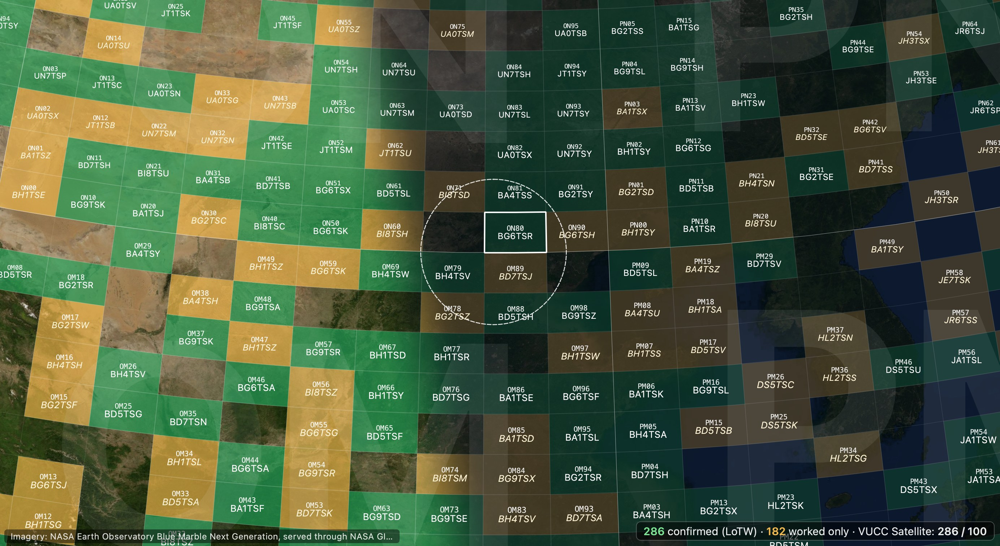
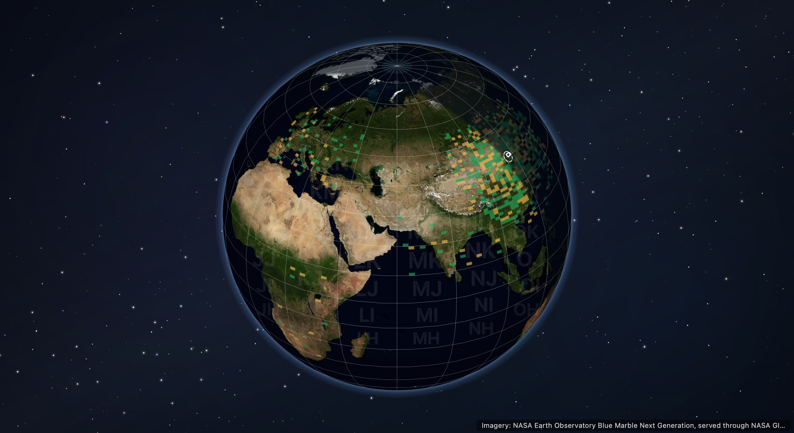

# NWOlogger

> **测试阶段，尚未正式发布。**

[English](README.md) · 简体中文

一个简洁、跨平台的业余无线电日志程序，支持 macOS, Ubuntu 和 Windows。日常通联记录参考了 **MacLoggerDX**，竞赛操作参考了 **N1MM Logger+**，采用独立设计的现代界面，使用 Python 和 Qt（PySide6）开发。

> - 通联记录、搜索、批量编辑、重复通联检查、纸质 QSL 卡片管理、ADIF、MacLoggerDX 数据迁移和竞赛模式均已实现并经过测试。
> - 已使用真实账户测试 LoTW、eQSL、QRZ.com 和 HRDLog 上传，LoTW、eQSL 和 QRZ.com 下载，以及 QRZ.com 呼号查询。HamQTH 尚未使用真实账户验证。
>
> - **设计文档**：[PLAN.md](PLAN.md)
> - **待办事项**：[TODO.md](TODO.md)

## 截图


*主窗口：录入表单位于日志上方。输入时会提示可能重复的通联，点击 **Compare…** 可打开对比窗口。Worked before 会列出相似呼号；图中有三个呼号与 JA1TSQ 仅相差一个字符。*

| | |
|---|---|
|  |  |
| *并排对比三个可能重复的通联。单元格可直接编辑；Merge… 可逐项选择合并后保留的内容。* | *CQ WW 竞赛模式：录入栏、实时分数、Check Partial 和 N+1。* |
|  |  |
| *深色主题* | *简体中文* |
|  |  |
| *偏好设置 → 模式：选择下拉列表中的模式并调整顺序* | *偏好设置 → 设备：管理电台、天线和设备组合* |

所有截图均使用虚构的通联记录。运行 `uv run python tools/screenshots.py` 可重新生成截图（网格地图截图会下载 NASA 影像；加 `--offline` 则不带影像）。

## 网格地图

网格地图（统计标签页，Ctrl+4）参考 GridMaster 和 GridTracker，把你通联过的每个 4 位 Maidenhead 网格画在可旋转的地球上，底图为卫星影像。


*中国及周边，再放大半级：每个网格都显示网格编号和首次确认它的呼号。绿色为已确认（此处为 LoTW），琥珀色为仅通联。角落的统计同时显示 VUCC 进度；虚线圆为本站网格周围 200 km。*

| | |
|---|---|
|  |  |
| *放大后：网格编号和呼号以完整大小显示，仅通联网格的呼号为斜体。本站网格有白框，虚线圆为其周围 200 km。* | *全部波段，整个地球：按当前 UTC 时间为夜晚一侧加阴影，晨昏线清晰可见。* |

- **网格**：按你勾选的确认来源（默认 LoTW，可任意组合 eQSL、QRZ.com 和纸质卡片）确认的网格为绿色，仅通联的为琥珀色，均标注首个呼号。从全国视图再放大约半级起显示网格编号和呼号，并随放大逐渐变大。所有呼号大小相同、字体纤细，短呼号不会比长呼号大，并同时出现。网格足够大时，已通联网格带浅色边线，相邻网格不会连成一片。两字母大网格名称以 8% 不透明度显示在其 100 个网格上。
- **筛选**：一颗卫星或一类轨道（LEO、MEO、HEO、GEO，或除静止轨道外的全部卫星；列表包含每颗卫星及其 QSO 数）、单个波段或全部波段，以及模式组。“呼号”和“网格”列出日志中的电台呼号和你操作过的地点，并带数量：持有多个呼号时可勾选多个，“200 km 以内”勾选 VUCC 和 GridMaster 统计的地点（默认）。地图角落的统计行显示已确认、仅通联的网格数和 VUCC 进度，并一并保存在 PNG 里。
- **区域**：本站网格周边、中国及周边、CONUS 488（勾勒 GridMaster 网格并显示数量）、欧洲、日本、全球。
- **操作**：用鼠标右键或中键拖动（触控板按住 Ctrl 拖动）或方向键旋转地球；左键点击网格可在日志中查看其通联；滚轮、双击或 +/− 缩放。“在独立窗口打开”把地图和控件放进自己的窗口，窗口大小和位置会被记住；窗口的全屏按钮或 F11 铺满屏幕，按 Esc 返回。
- **保存为 PNG**：按你看到的样子保存地图，像素尺寸为两倍，以勾选的呼号和地点命名（`BI1NWO at ON80 - NWOlogger 0.1.9.png`，多于一个时加 *et al*），地图上方单独一栏写着这个文件名，角落里放大显示统计：已确认为绿色，仅通联为琥珀色。
- **晨昏线**：按当前 UTC 时间为夜晚一侧（包括网格）加阴影，沿晨昏线有清晰的边界（与 PSK Reporter 地图相同），自动更新，并记住开关状态（默认开启）。地球背后是星空和淡淡的银河。
- **影像**（偏好设置 → 地图）：NASA Blue Marble（无需密钥）或天地图 Tianditu（需要免费开发者密钥）。影像、网格和夜间阴影按显示器自身分辨率绘制，包括 Retina 屏幕。瓦片在后台加载并保存在系统缓存目录（上限 300 MB），看过的区域离线也能打开。

## 安装

安装、首次运行、故障排查以及 macOS / Windows 打包说明见 [INSTALLATION.md](INSTALLATION.md)（英文）。

## 功能

- **一个 SQLite 文件**保存所有通联记录。
  - 数据列直接采用 ADIF 字段名，可使用任意 SQLite 工具查询日志。
  - 打开日志，以及每次导入或批量编辑前，都会自动备份。
  - **定期备份**：默认每 7 天一次（偏好设置 → 数据库，可设 1 到 365 天）。自上次以来有通联记录、修改或删除时，自动往 `backups/` 复制一份，与启动副本分开计数；同时弹出一个小窗口提醒你把日志复制到另一块硬盘或云盘文件夹，“备份到…”会记住那个文件夹。
  - 删除通联不会让文件变小；“文件 → 压缩日志文件”会在备份后重建文件，去掉删除留下的空间。
  - 文件里记录着创建它和最后写入它的 NWOlogger 版本（关于 → 系统信息）。用比最后写入者更旧的 NWOlogger 打开会先提醒；不是 NWOlogger 日志的文件会被拒绝打开，而不是被改写。“帮助 → 打开日志文件所在文件夹 / 打开备份文件夹”可直接打开这些目录。
- **ADIF 导入和导出**：可导出全部、选中或筛选后的通联。NWOlogger 不认识的字段也会保留，并在导出时写回。从 LoTW 网站保存的 LoTW 报告（`lotwreport.adi`）会像从 LoTW 下载一样应用：日志中对应的通联获得 LoTW 确认及其日期，日志中没有的通联会被添加（疑似重复的会等你勾选）。导入的日志还会根据其中的确认信息设置下载的续传位置（取最新确认的前一天，不会晚于已有位置）；LoTW 报告则使用自己文件头里的时间戳。
- **MacLoggerDX 数据迁移**：直接读取其数据库，保留 LoTW、eQSL、QRZ 和 HRDLog 上传历史，以及 MacLoggerDX 自带 ADIF 导出会遗漏的纸质卡片日期。
  - MacLoggerDX 只记录它自己完成的上传。已获得 LoTW 或 QRZ.com 确认的通联，必然已上传到对应服务，因此也会标记为已上传；ADIF 导入采用相同规则，导入预览会统计这些记录。首次上传前，建议先从 LoTW 和 QRZ.com 下载，以补全其余上传状态。
- **搜索**：支持同时使用多个条件，呼号支持 `?` / `*` 通配符。网格条件会查看一条 QSO 的全部网格（`GRIDSQUARE` 和 `VUCC_GRIDS`）：`OM89` 能找到报了 `OM88, OM89` 的电台，多个网格可按任意顺序输入，单独一个逗号或分号列出所有带多个网格的 QSO；呼号栏里的 `/` 列出移动呼号。模式默认采用模糊匹配（`SSB` 可找到 USB/LSB，`DIGI` 可找到 FT8），也可选择精确匹配。搜索条件可以保存。
- **排序**：可按任意列排序，包括卫星名称、开始时间和结束时间；各列可显示、隐藏和移动。
- **录入表单**：
  - 发射 / 接收频率支持全部 33 个 ADIF 波段，包括 30 m、17 m 和 12 m，可通过 **= TX** 开关同步。可直接输入 MHz 数值，也可注明 Hz、kHz、MHz 或 GHz 单位；竞赛录入中不带单位的数值按 kHz 处理。
  - 模式、传播方式（采用 TQSL 列表）和卫星使用下拉列表。
    - 可自行选择常用模式和卫星；通过“其他…”访问其余条目。
    - 可添加自定义卫星。
    - 传播方式不是 SAT 时仍会保留卫星信息，同时显示提醒。
  - **设备**区域包含电台（`MY_RIG`）、天线（`MY_ANTENNA`）和功率（`TX_PWR`）。在“偏好设置 → 设备”中创建组合后，可一次填入三项，也可逐项修改；留空时采用台站配置中的值。
  - **备注（上传）**（`COMMENT`，发送给 eQSL、QRZ.com 和 HRDLog）和**笔记（本地）**（`NOTES`，从不上传）可记录所用中继、对方电台、天线和功率，以及自己的操作地点。
  - 结束时间默认跟随开始时间加 1 分钟，不允许早于开始时间。点击开始时间旁的“现在”可恢复实时计时。
  - “保留”选项可让字段在整个卫星过境期间保持不变。“清空”会清除本次通联内容，保留设备区域。
  - 电台、天线或功率留空时，使用台站配置中的值，并以灰色提示。
  - 一个“网格”字段可填站在网格线上的电台报出的两个或四个网格（`OM88, OM89`，也可用 `;` 或 `/` 分隔）：第一个写入 `GRIDSQUARE`，全部写入 `VUCC_GRIDS`；表单、日志的网格列、对比窗口和“曾经通联”都会一起显示。台站配置里你自己的网格同样处理。
- **网格地图**（统计标签页，Ctrl+4）：在可旋转的地球和卫星影像上显示你通联过的每个网格，已确认为绿色、仅通联为琥珀色，并标注首个呼号。详见上文[网格地图](#网格地图)。
- **相似呼号**：输入时，“曾经通联”区域会显示相同呼号、包含或以输入内容开头的呼号，以及仅相差一个字符的呼号（输入错误、缺少字母或数字）。依次查找本地日志（最近通联优先）、QRZ.com / HamQTH 已知呼号、ARRL 的 [LoTW 用户列表](https://lotw.arrl.org/lotw-user-activity.csv)和 eQSL AG 会员列表（约 32 万个呼号，附各呼号最近一次 LoTW 上传日期），最后查找 MASTER.SCP。若 QRZ.com / HamQTH 查不到某个呼号，会继续查询 MASTER.SCP 中最多三个仅相差一个字母的候选呼号。使用 `*` 或 `?` 时，呼号栏会像日志搜索框一样搜索所有来源（`BA*K` → BA1PK、BA8BLK）。
  - QRZ.com 和 HamQTH 只能查询完整呼号，因此公共呼号列表会先下载到日志文件旁，每周更新，并在输入时于本机搜索。也可通过“文件 → 更新 LoTW 和 eQSL 呼号列表”手动更新。
- **台站配置**：“从我的日志添加…”列出 QSO 里出现过的每一对电台呼号 + 网格及其数量，为你勾选的每一对创建配置。导入从不把 QSO 挪到某个配置上：记录保留它自带的电台呼号和网格，导入预览会写明有多少条记录没有电台呼号（只有这些记录会使用所选配置）。关闭偏好设置时，若台站配置有未保存的修改，会提供保存、放弃或取消选项；点击窗口关闭按钮或按 Esc 也会检查。
- **操作员**：录入表单包含操作员字段。
  - 个人台站自动填写本站呼号。
  - 俱乐部台站必须填写操作员，随后在本次会话中保留。
  - 进入新的 UTC 日期，或间隔超过 3 小时后，该字段会变为琥珀色，提示核对一次。
- **严格检查重复通联**：
  - 只有相同呼号、相同波段、完全相同模式且相隔不超过 30 秒，才会阻止录入。
  - 随后一分钟内的同模式通联（提醒时间窗，可在偏好设置中修改；旧版本保存的 24 小时会变为 1 分钟），或使用相关模式的通联（如 SSB 与 USB、USB 与 LSB、FT8 与 FT4），仅显示提醒。检查重复或修改时间窗时会先重新扫描标记，旧时间窗留下的标记不会残留。
  - 对比窗口以每条通联一列的方式展示整组疑似重复记录。可直接编辑单元格、逐字段合并（在有差异的行中点击要保留的值；确认和上传状态会合并）、删除，或标记为非重复；也可一次处理整组记录（需两次确认）。“编辑 → 合并所选…”可合并同一呼号的 2–5 条选中通联。
- **批量编辑**：修改前可预览，即使选中几千条通联，输入时预览也能及时更新。无法识别的时间或日期会被拒绝，不会写入。修改前会先备份日志。
- **按服务分别记录电子确认**：LoTW（通过 TQSL）、eQSL 和 QRZ.com Logbook 支持上传和下载；HRDLog.net 仅支持上传。卫星名称会按服务转换，例如国际空间站在 LoTW 中为 `ARISS`，在 eQSL 中为 `ISS`。
  - 呼号显示为**绿色**表示该通联已获得 LoTW 确认；eQSL、QRZ.com 和纸质卡片确认不会使其变绿。选中该行时仍保持绿色，重复通联仍为红色。
  - **上传始终由你决定。**“全部同步”仅执行下载。尚未上传到全部四个服务的通联以灰色显示（提示文字会列出缺少的服务）；可使用“未上传到所有服务”预设筛选，再通过“上传所选”发送。
  - 下载还会补充已有上传状态：LoTW 的已接收通联报告和 QRZ.com 日志会将对应记录标记为已上传。eQSL 只提供收件箱，HRDLog 不支持下载，因此它们无法告知 NWOlogger 此前上传了哪些通联。
  - **下载到的、日志中没有的通联会被添加**（LoTW、eQSL、QRZ.com，以及从文件导入的 LoTW 报告），并带上该服务的确认。与某条已记录通联同呼号、相差一分钟以内的记录（不论波段、模式或卫星）会先放在“疑似重复”窗口里：勾选要添加的，或打开它可能重复的那条通联。将下载的通联添加到空日志时，会保留 LoTW、eQSL 或 QRZ.com 确认状态。
  - **网络不好也不会前功尽弃**：每次下载先写入日志旁的文件（`downloads/`，与 `backups/` 并列；保留每个服务最后一份完整文件和所有未完成的文件），会自动重试，并在服务允许时续传：LoTW 按年分段、eQSL 按字节范围、QRZ.com 按页。即使后面失败，已到达的部分也会应用，下次从那里继续。下载失败后可立即重试；只有成功应用到本地日志的下载才会开始计入下载间隔。“从某一天起下载…”可从你指定的日期开始获取 LoTW 确认。
  - **同步位置**（偏好设置 → 同步位置）显示每个服务下次下载从哪里继续：LoTW 的确认和上传时间戳、eQSL 的日期、QRZ.com 最后的日志 id。它们默认锁定；“解锁”后可在红色危险区域里修改，“锁定并保存”写入。
  - 首次从 LoTW 下载时，若完整通联报告包含所需时间戳，会直接从中提取确认，避免再下载一遍完整确认报告。
  - 所有结果统一显示在不阻塞操作的**同步结果**窗口中（QSL → 显示同步结果）。可通过设置解决的错误会提供“打开偏好设置”按钮。
  - **同步历史**保留每次运行。“清除历史…”（或 QSL → 清除同步历史…）可按服务删除历史，例如仅清除 QRZ.com 历史，不影响通联及其上传、确认状态。
  - 发送前会检查各台站配置的 TQSL 台站位置（偏好设置中可选择 TQSL 中已有的位置）和 eQSL QTH 昵称。
  - TQSL 可在自身窗口等待操作，例如输入证书口令；点击“取消”可停止。退出 NWOlogger 时会先询问，再停止 TQSL，避免一直等待。
- **纸质 QSL 卡片**：分别记录寄出和收到日期，以及经卡片局、直寄或管理员交换的方式，并提供待寄队列。“回复已收到的纸卡…”把收到了卡却没有寄出的通联加入待寄队列；右键菜单的“标记纸质卡未寄出 / 未收到”清空对应方向。
- **呼号查询**：先使用离线呼号实体文件（`cty.csv`，每周更新），再查询 QRZ.com XML，必要时回退到 HamQTH。中国省级行政区会规范为标准代码（BJ、SC 等）。
- **竞赛模式（N1MM 风格）**：
  - 下拉选择 CQ WW、CQ WPX、IARU HF、ARRL DX、ARRL 10 m、All Asian、CQ WW VHF、通用模板或自定义竞赛。
  - 实时检查重复通联，提供 Check Partial / N+1，以及实时分数、系数和速率。
  - 支持 Cabrillo 导出。
- **现代界面**：浅色和深色主题，优先支持键盘操作（命令面板 ⌘K / Ctrl+K），提供**英文和简体中文**。窗口和偏好设置会适应可用桌面，必要时可滚动，包括 Windows 250% 显示缩放；偏好设置的各页列在左侧，任何宽度下都全部可见。

本项目不提供电台控制功能，NWOlogger 不会与无线电设备通信。

## 快捷键

| 按键 | 操作 |
|---|---|
| Enter | DX 模式记录通联；竞赛模式跳到下一个空字段，填完后记录 |
| Esc | 清空录入表单 / 竞赛录入栏 |
| Space（竞赛） | 下一个字段 |
| `14025` + Enter、`CW` + Enter（竞赛呼号栏） | 设置频率或模式 |
| ⌘K / Ctrl+K | 命令面板 |
| ⌘L / Ctrl+L | 焦点移到呼号栏 |
| ⌘F / Ctrl+F | 搜索日志 |
| ⌘B / Ctrl+B | 批量编辑所选通联 |
| ⇧⌘D / Ctrl+Shift+D | 检查疑似重复通联 |
| ⇧⌘O / Ctrl+Shift+O | 跳到操作员字段 |
| ⌘1–3 / Ctrl+1–3 | 日志 · 纸质 QSL · 同步历史标签页 |
| ⇧⌘1 / ⇧⌘2 | DX 视图 / 竞赛视图 |

## 项目结构

```text
NWOlogger/
├── nwologger/                  应用程序（Python 包）
│   ├── __main__.py            命令行：nwologger [--db FILE] [--lang zh_CN] [--theme dark] [--debug] [--version]
│   ├── app.py                 启动 Qt，设置语言、主题、日志文件和主窗口
│   ├── applog.py              诊断日志（隐藏敏感信息）和卡顿监测
│   ├── i18n.py                tr()：从 resources/translations/ 查找界面译文
│   ├── core/                  不依赖 Qt 的业务逻辑（有单元测试）
│   │   ├── db.py              SQLite 日志：结构、迁移和备份
│   │   ├── fields.py          各 QSO 字段的 ADIF 名称、类型和标签
│   │   ├── qso.py, adif.py    QSO 数据清理；ADIF 读写
│   │   ├── importer.py, exporter.py, mldx.py      导入（重复标记、合并）、导出、MacLoggerDX
│   │   ├── search.py          筛选条件转 SQL（通配符、模糊 / 精确模式）
│   │   ├── dupes.py, modes.py, bands.py           重复规则、模式关系和波段表
│   │   ├── callsign.py, dxcc.py, regions.py, geo.py   呼号、实体文件、中国省级代码和网格
│   │   ├── grids.py, globe.py, solar.py              网格统计、球面投影和太阳位置
│   │   ├── similar.py         相似呼号（日志、QRZ.com / HamQTH 缓存、呼号列表、MASTER.SCP）
│   │   ├── calllists.py       LoTW 用户和 eQSL AG 会员列表下载及快速搜索
│   │   ├── net.py, secrets.py 通过 HTTPS 访问服务，下载写入文件并可重试、续传，消息不含密钥；系统密钥链访问
│   │   ├── sats.py, propagation.py                卫星、各服务名称和 TQSL 传播方式
│   │   ├── operators.py       个人台站 / 俱乐部台站操作员
│   │   ├── devices.py         设备区域的电台、天线和组合
│   │   ├── lookup/            QRZ.com XML、HamQTH
│   │   ├── sync/              LoTW + TQSL、eQSL、QRZ.com Logbook、HRDLog 及确认状态处理；positions.py：下载的续传位置
│   │   └── contest/           计分引擎、内置定义（defs/*.json）、Check Partial、Cabrillo
│   ├── ui/                    Qt 窗口和控件
│   │   ├── main_window.py     工具栏、菜单、标签页和操作
│   │   ├── entry/dx_panel.py  DX 录入表单
│   │   ├── log/               日志表格模型 / 视图、筛选栏和高级搜索
│   │   ├── contest/           竞赛录入栏、面板、设置和自定义竞赛
│   │   ├── stats/             统计标签页的筛选和独立窗口（statistics_tab.py）；球形视图（gridmap.py）；逐像素绘制影像、网格和夜间阴影（globeraster.py）；轮廓（globegeometry.py）
│   │   ├── dupe_dialog.py     并排比较重复记录、编辑和逐字段合并
│   │   ├── operator_field.py  操作员字段（个人 / 俱乐部台站规则）
│   │   ├── list_picker.py     “其他模式… / 其他卫星…”搜索
│   │   ├── sync_controller.py, sync_dialogs.py   窗口中的下载和上传；下载通联中的疑似重复
│   │   ├── bulk_edit.py, qsl_paper.py, import_dialog.py, prefs_dialog.py, profiles_from_log.py, about_dialog.py, …
│   │   └── theme.py           配色、浅色 / 深色样式和图标
│   └── resources/             cty.csv、sats.json、图标（Lucide）、brand/（应用图标）、translations/zh_CN.json
├── tests/                     pytest 测试；fixtures/sample.adi 为试用的虚构日志
├── tools/screenshots.py       用虚构数据生成 docs/screenshots/ 截图
├── docs/screenshots/          README 截图
├── packaging/                 PyInstaller 配置、Inno Setup 脚本（Windows 安装程序）、打包后应用的冒烟测试
├── .github/workflows/         CI（Linux、macOS 和 Windows 测试）和三个平台的发布构建
├── PLAN.md, TODO.md           设计和待办事项
└── pyproject.toml, uv.lock    项目元数据和锁定的依赖
```

## 隐私

- 密码、上传码和 API 密钥只存入系统密钥链（macOS Keychain / Windows Credential Manager）。其他 keyring 后端（如明文文件）会被拒绝。
  - 保存后不再显示密钥。偏好设置中的“忘记”可删除对应密钥；重命名账户会删除旧账户的条目。
  - 删除某呼号的最后一个台站配置时，也会删除该呼号的 QRZ Logbook 密钥。
- 即使服务将敏感信息编码后返回，错误消息、同步历史和日志也不会包含密码、密钥、上传码或会话令牌。所有请求及重定向仅通过 HTTPS 访问相应服务自己的主机。QRZ.com XML 的密码和会话密钥放在请求正文中；LoTW 和 eQSL 仅接受通过加密 URL 传递。即使应用使用 DEBUG 日志级别，也不启用 HTTP 请求日志。
- 诊断日志位于 macOS 的 `~/Library/Logs/NWOlogger/`、Windows 的 `%LOCALAPPDATA%\NWOlogger\Logs`，或 Linux 的 `~/.local/state/nwologger/`。日志会隐藏 NWOlogger 读取过的所有密钥和账户用户名，包括异常堆栈和返回的错误页面；请求仅记录主机和路径，从不记录 URL 查询参数；主目录以 `~` 显示。日志记录数量和设置名称，不保存通联内容。
- LoTW 用户列表和 eQSL AG 列表是公开文件，无需登录即可下载。搜索这些列表时，不会将你输入的内容发送出去。
- 网格地图仅向影像服务请求当前视野内的瓦片，因此服务可知你查看的区域，但不会收到通联记录。瓦片保存在系统缓存目录（macOS 为 `~/Library/Caches/NWOlogger`），上限 300 MB；“偏好设置 → 地图 → 清除地图缓存”可清空。天地图密钥保存在系统密钥链中。
- 上传至 LoTW、eQSL、QRZ.com 和 HRDLog 时，仅发送标准 ADIF 字段，不发送其他程序的 `APP_…` 字段。疑似凭据的导入字段（`EQSL_PSWD`、`…PASSWORD…`、`…TOKEN…`、`APP_…_KEY`）会被排除，也不会导出。
- 不要提交真实日志文件。`*.sql`、`*.sqlite`、`*.adi` 等已加入 Git 忽略列表，因为其中可能包含其他操作员的个人数据。仅提交 `tests/fixtures/` 下的虚构测试文件。

## 致谢

- **作者**：Han Zhang（BI1NWO）、Claude Opus 5.5 Extra High（Anthropic）和 GPT-6.1 Sol Ultra（OpenAI）。版权所有 © 2026 Han Zhang。
- **特别感谢** [BY1QH](https://www.qrz.com/db/BY1QH) 俱乐部台站，NWOlogger 图标使用其台标；台标由王亦童（BI1TYE）设计。
- **数据**：AD1C 呼号实体文件（[country-files.com](https://www.country-files.com/)）、ARRL LoTW / TQSL 列表、Super Check Partial。
- **软件**：图标来自 [Lucide](https://lucide.dev/)（ISC 许可证）；界面使用 Qt for Python（PySide6）。
- **网格地图可视化**参考了 [GridmasterMap（FG8OJ）](https://gridmaster.fr/) 和 [GridTracker](https://gridtracker.org/)。


## 许可证

[MIT](LICENSE)
